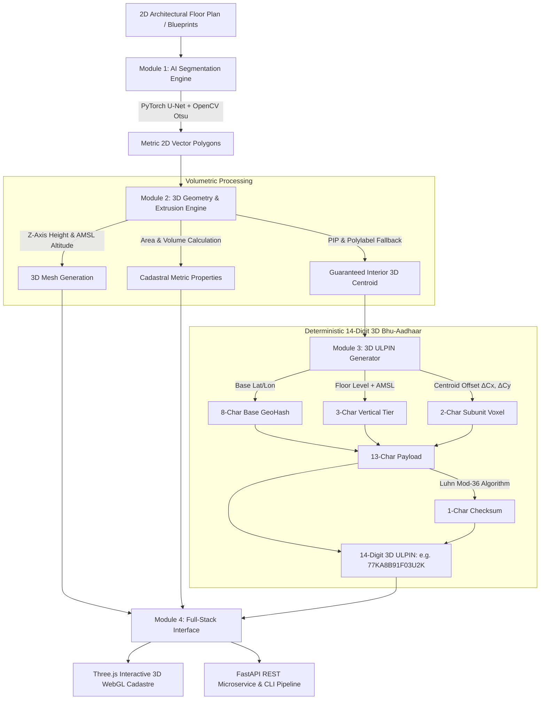

# 🏛️ 3D ULPIN & Vertical Property Mapping System
### *3D Bhu-Aadhaar Generation & Cadastral Digital Twin Engine*

[](https://www.sih.gov.in/)
[](https://dolr.gov.in/)
[](https://react.dev/)
[](https://threejs.org/)
[](https://fastapi.tiangolo.com/)
[](https://pytorch.org/)
[](https://www.typescriptlang.org/)
[](https://tailwindcss.com/)
[](LICENSE)

---

## 📌 Overview

The **3D ULPIN & Vertical Property Mapping System** is a next-generation geospatial engineering platform designed for the **Department of Land Resources (DoLR), Ministry of Rural Development**, addressing **Smart India Hackathon (SIH 2026) Problem Statement SIH26011**.

While India's traditional **ULPIN (Unique Land Parcel Identification Number / Bhu-Aadhaar)** provides a 14-digit alphanumeric geocode for 2D land parcels, modern urban verticalization introduces a fundamental challenge: **multiple property owners occupy distinct vertical volumes within the exact same 2D parcel footprint**.

This platform bridges that gap by introducing:
1. **Automated AI Floor Plan Segmentation** to extract metric unit boundaries from architectural raster blueprints.
2. **Volumetric 3D Extrusion** with Point-in-Polygon (PIP) validation and Pole of Inaccessibility (`polylabel`) fallback.
3. **Deterministic 14-Digit 3D ULPIN (3D Bhu-Aadhaar)** encoding with altitude above mean sea level (AMSL) and Mod-36 Luhn checksums.
4. **Interactive 3D Cadastral Digital Twin** powered by Three.js WebGL for visual property deed verification, vertical explosion analysis, and multi-unit cadastre management.

---

## 🚀 Key Features

- **🧠 Deep Learning Floor Plan Vectorization**: PyTorch U-Net coupled with OpenCV adaptive bilateral filtering and Otsu thresholding automatically segments rooms, corridors, and apartment units from raster blueprints into clean 2D vector polygons via Douglas-Peucker simplification.
- **📐 3D Volumetric Extrusion Engine**: Computes exact unit floor area ($m^2$), 3D airspace volume ($m^3$), vertical bounding boxes, and 3D centroid coordinates anchored to Altitude Above Mean Sea Level (AMSL).
- **🛡️ Geometric Interiority Guarantee**: Implements Shapely Point-in-Polygon (PIP) and automatic Pole of Inaccessibility fallback (`shapely.ops.polylabel`) to ensure 3D ULPIN anchor coordinates strictly reside inside concave or L-shaped apartments.
- **🔢 14-Digit Deterministic 3D ULPIN Standard**: Fully compliant with DoLR's 14-character length constraint:
  - `8 chars`: Base Cadastral GeoHash (~0.19m ground boundary accuracy)
  - `3 chars`: Vertical Floor Tier & Elevation (Basement `B`, Ground `G`, Floor `F`, High-rise `H`)
  - `2 chars`: Sub-unit Spatial Voxel Hash ($36 \times 36 = 1296$ unique unit bins per floor)
  - `1 char`: Luhn Mod-36 Checksum (100% single-character transcription error detection)
- **🏙️ High-Fidelity 3D WebGL Digital Twin**: Interactive Three.js viewport featuring:
  - **Vertical Floor Explosion Slider**: Smoothly separates building storeys along the Z-axis for clear floor-by-floor inspection.
  - **Interactive Raycasting**: Click any volumetric unit to inspect legal cadastral deeds, owner names, tax IDs, and ULPIN breakdowns.
  - **Floor Isolation & View Filters**: Isolate specific storeys or toggle translucent building shells.
  - **CAD Wireframe & Shadow Rendering**: Directional solar lighting and edge geometries for architectural clarity.
- **⚡ Dual Runtime Architecture**:
  - **Interactive React 19 Frontend**: Real-time browser-based cadastral generation, presets, and 3D visualization.
  - **Production FastAPI Backend & CLI**: High-throughput microservice and CLI pipeline (`pipeline_runner.py`) exporting 3D OBJ meshes and GeoJSON cadastral records.

---

## 🏗️ System Architecture



---

## 📐 14-Digit 3D ULPIN Structure

The 14-digit **3D Bhu-Aadhaar** format extends India's national land standard into the 3rd vertical dimension without exceeding the 14-character database schema:

$$\text{ULPIN}_{14} = \underbrace{\text{GeoHash}_8}_{\text{Base Parcel}} + \underbrace{\text{Tier}_3}_{\text{Vertical Level}} + \underbrace{\text{Voxel}_2}_{\text{Subunit Bin}} + \underbrace{\text{Checksum}_1}_{\text{Luhn Mod-36}}$$

| Segment | Length | Alphabet | Description | Example |
|---|:---:|:---:|---|:---:|
| **Base Cadastral Geocode** | 8 chars | Base36 | Encodes base land parcel centroid (WGS84 Lat/Lon). Ground precision $\approx 0.19\text{ m}$. | `77KA8B91` |
| **Vertical Floor Tier** | 3 chars | `[B/G/F/H]` + Base36 | Vertical floor level & altitude above mean sea level (`B` = Basement, `G` = Ground, `F` = Floors 1–35, `H` = High-rise towers). | `F03` *(Floor 3)* |
| **Subunit Voxel Hash** | 2 chars | Base36 | Discretizes internal $(\Delta X, \Delta Y)$ unit centroid offset into $36 \times 36 = 1296$ unique per-floor coordinate bins. | `U2` |
| **Mod-36 Luhn Checksum** | 1 char | Base36 | Weighted Mod-36 check digit covering the preceding 13 alphanumeric characters for error detection. | `K` |
| **Full 3D ULPIN** | **14 chars** | **Alphanumeric** | **Complete unique 3D vertical property cadastral identifier.** | **`77KA8B91F03U2K`** |

Formatted output for legal documentation: `77KA8B91-F03-U2-K`.

---

## 📂 Repository Structure

```
3D-ULPIN-Vertical-Property-Mapping-System/
├── backend/                               # Python FastAPI Microservice & Pipeline
│   ├── geometry_builder.py                # Shapely 3D volumetric extrusion & polylabel engine
│   ├── main.py                            # FastAPI REST API (endpoints for segmentation & ULPIN)
│   ├── pipeline_runner.py                 # Standalone CLI orchestration pipeline
│   ├── requirements.txt                   # Python dependencies (Torch, Shapely, OpenCV, etc.)
│   ├── segmentation_engine.py             # PyTorch U-Net & OpenCV contour extraction
│   └── ulpin_generator.py                 # Deterministic 14-digit 3D ULPIN encoder/decoder
├── src/                                   # React 19 + Three.js Web Application
│   ├── components/
│   │   ├── Cadastral3DViewer.tsx          # Three.js WebGL 3D building viewer & raycaster
│   │   ├── CodeAndArchitectureExplorer.tsx# In-browser architecture & code documentation viewer
│   │   ├── SegmentationWorkbench.tsx      # AI floor plan segmentation & vectorization UI
│   │   ├── UlpinDecoderWorkbench.tsx      # 14-digit 3D ULPIN validator & structural decoder
│   │   └── UnitDetailModal.tsx            # Volumetric property title deed modal
│   ├── types/
│   │   └── cadastre.ts                    # TypeScript data definitions & geometric schemas
│   ├── utils/
│   │   ├── extrusion3D.ts                 # Client-side 3D mesh building & raycast geometry
│   │   ├── floorplanPresets.ts            # Architectural sample blueprints (residential, commercial, L-shaped)
│   │   └── ulpin.ts                       # TypeScript implementation of 3D ULPIN & Luhn Mod-36
│   ├── App.tsx                            # Primary application dashboard
│   ├── index.css                          # Global styling (Tailwind CSS v4)
│   └── main.tsx                           # Application entry point
├── package.json                           # Node.js project manifest & scripts
├── tsconfig.json                          # TypeScript configuration
├── vite.config.ts                         # Vite configuration
├── metadata.json                          # System metadata
├── .env.example                           # Environment configuration template
└── README.md                              # Project documentation
```

---

## 🛠️ Quick Start Guide

### Prerequisites
- **Node.js**: v18.0.0 or higher
- **npm** or **bun**: Package manager
- **Python**: v3.10+ (for backend pipeline & ML services)

---

### Option 1: Launch the Interactive 3D Web Workbench (Frontend)

The frontend contains full client-side volumetric extrusion, floorplan vectorization, and 3D ULPIN generation engines ready out of the box.

```bash
# 1. Install dependencies
npm install

# 2. Start the Vite development server
npm run dev
```

Open your browser and navigate to:
```
http://localhost:3000
```

---

### Option 2: Run the Python Backend Microservice

The Python backend provides the deep learning PyTorch segmentation pipeline, high-precision Shapely geometric processing, and headless batch export.

```bash
# 1. Navigate to backend directory
cd backend

# 2. Create and activate a virtual environment (optional but recommended)
python3 -m venv venv
source venv/bin/activate    # On Windows: venv\Scripts\activate

# 3. Install backend dependencies
pip install -r requirements.txt

# 4. Start the FastAPI development server
uvicorn main:app --host 0.0.0.0 --port 8000 --reload
```

Interactive Swagger API documentation will be available at:
```
http://localhost:8000/docs
```

---

### Option 3: Run the Standalone CLI Pipeline

Process any floor plan image into a complete 3D cadastre directly from the command line:

```bash
cd backend
python pipeline_runner.py \
  --image sample_floorplan.png \
  --floors 5 \
  --ceiling 3.2 \
  --lat 28.613939 \
  --lon 77.209021 \
  --elevation 215.0 \
  --output ./output
```

**Pipeline Outputs:**
- `output/cadastral_units_3d.json`: Full cadastral dataset with 14-digit 3D ULPINs, volumes, areas, and bounds.
- `output/building_mesh.obj`: Wavefront 3D OBJ file ready for AutoCAD, GIS (QGIS/ArcGIS), or Blender.
- `output/sample_floorplan_generated.png`: Annotated segmentation mask with unit centroids.

---

## 🌐 FastAPI REST Endpoints

| Method | Endpoint | Description |
|---|---|---|
| `GET` | `/api/health` | Service health status and system version |
| `POST` | `/api/process-floorplan` | End-to-end multipart endpoint: Ingests blueprint image $\rightarrow$ segments units $\rightarrow$ extrudes 3D meshes $\rightarrow$ generates 3D ULPINs |
| `POST` | `/api/verify-ulpin` | Validates a 14-digit 3D ULPIN via Luhn Mod-36 and returns structural breakdown (floor tier, voxel, geocode) |
| `POST` | `/api/extrude-cadastre` | Extrudes raw 2D polygon arrays into 3D meshes with Point-in-Polygon validation |

#### Example: Verify & Decode a 3D ULPIN
```bash
curl -X POST "http://localhost:8000/api/verify-ulpin" \
  -H "Content-Type: application/json" \
  -d '{"ulpin": "77KA8B91F03U2K"}'
```

**Response:**
```json
{
  "isValid": true,
  "baseGeocode": "77KA8B91",
  "floorTier": "F03",
  "floorType": "Upper Floor",
  "decodedFloorNumber": 3,
  "voxelHash": "U2",
  "checksum": "K"
}
```

---

## 🧮 Algorithmic Rigor & Geometric Integrity

### 1. Pole of Inaccessibility (`polylabel`)
Standard mathematical centroids often fall outside non-convex geometries (such as L-shaped apartments, wrap-around penthouses, or units with interior courtyards). 
The system tests each unit with **Shapely Point-in-Polygon (PIP)**. If the centroid lies outside the boundary, it automatically triggers an iterative quadtree algorithm (`shapely.ops.polylabel`) to locate the **Pole of Inaccessibility**—the point inside the polygon furthest from any outer wall—guaranteeing that every 3D ULPIN anchor point exists within legal property bounds.

### 2. Mod-36 Luhn Checksum Algorithm
To prevent clerical and transcription errors in deed registration, the 14th character of each 3D ULPIN uses a Base36-adapted Luhn formula with cyclic weights $[1, 3, 7, 9]$:

$$\text{CheckSum} = \left(36 - \left(\sum_{i=0}^{12} \text{Base36Val}(c_i) \times W_{i \pmod 4} \pmod{36}\right)\right) \pmod{36}$$

This mathematical property guarantees **100% detection of single-character substitution errors** and adjacent transpositions.

---

## 💻 Tech Stack

- **Frontend**: React 19, TypeScript, Vite, Three.js, Tailwind CSS v4, Lucide React, Motion, Canvas-Confetti
- **Backend**: Python 3.10+, FastAPI, Uvicorn, Pydantic v2
- **Computer Vision & AI**: PyTorch, Torchvision, OpenCV, Pillow, NumPy
- **Spatial Geometry**: Shapely (GEOS), Trimesh, SciPy, Matplotlib
- **Standards**: WGS84, OGC Simple Features, Luhn Mod-36, GeoHash Base36, DoLR ULPIN Specification

---

## 👥 Contributors & Acknowledgements

Developed for **Smart India Hackathon 2026** under Problem Statement **SIH26011**.

Special thanks to:
- **Ministry of Rural Development & Department of Land Resources (DoLR)**, Government of India.
- **Digital India Land Records Modernization Programme (DILRMP)**.

---

## 📄 License

This project is licensed under the [MIT License](LICENSE).
